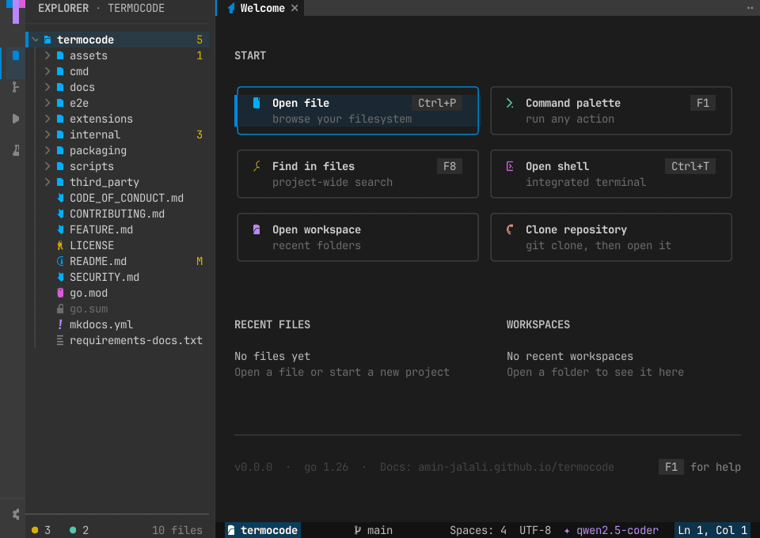

# termocode

[](https://amin-jalali.github.io/termocode/)
[](https://github.com/amin-jalali/termocode/actions/workflows/test.yml)

A terminal IDE that feels like VS Code — built on Bubble Tea, powered by a real Neovim process under the hood.

**Status:** early release (v0.1.x). Linux, macOS and Android (Termux). No Windows build yet; use WSL.

**Documentation: <https://amin-jalali.github.io/termocode/>**



<table>
  <tr>
    <td width="50%"><br><sub><b>Editor</b> — real Neovim, explorer with git status, tabs, breadcrumbs.</sub></td>
    <td width="50%"><br><sub><b>AI edit review</b> — accept or reject each change, then apply.</sub></td>
  </tr>
  <tr>
    <td><br><sub><b>Start page</b> — open files, recent files, workspaces, clone.</sub></td>
    <td><br><sub><b>Command palette</b> (<code>F1</code>) — every action, fuzzy search.</sub></td>
  </tr>
  <tr>
    <td><br><sub><b>Source Control</b> — commit box, change tree and commit graph.</sub></td>
    <td><br><sub><b>Terminal</b> — integrated shell panel under the editor.</sub></td>
  </tr>
  <tr>
    <td><br><sub><b>Markdown preview</b> — a clean reader view for <code>.md</code> files.</sub></td>
    <td><br><sub><b>Themes</b> — light and dark, here Catppuccin Latte.</sub></td>
  </tr>
</table>

## Highlights

- **Real Neovim** as the editor — your motions, registers and `init.lua` — inside tabs, an explorer and a command palette (`F1`).
- **AI assistant** — ghost-text completion, a chat panel with an agent, and Explain / Fix / Edit actions you review as a diff. Anthropic, OpenAI, OpenRouter or local Ollama.
- **Run and Debug** — breakpoints, watch, call stack and a Debug Console for Go, Python and Node, with `launch.json`.
- **Test explorer** for Go, pytest, Rust, Jest and Vitest, plus **tasks** and a **Problems** panel.
- **Git** — stage hunks, commit, sync, stash, blame, a commit graph, a merge-conflict resolver and clone.
- **Language servers** for Go, Python, JS/TS, Rust, C/C++, Lua and more — with a built-in installer.
- **Fast search** across every workspace folder with ripgrep: case / word / regex toggles and globs.
- **Make it yours** — themes (VSCode Dark+, Catppuccin Mocha / Latte, Tokyo Night, Rosé Pine / Dawn, …), a custom theme editor, Nerd Font / Unicode / ASCII icons, key rebinding, snippets, settings export, and **Lua extensions**.
- **Looks good everywhere** — rounded floating cards, status pills, smooth animations, inline images (kitty / sixel / half-blocks), and a clean fallback on 16-colour, no-Nerd-Font and SSH sessions.

## Install

termocode runs on Linux and macOS (amd64 and arm64). It needs `nvim` ≥ 0.10.
One line, no sudo — it installs to `~/.local/bin`:

```sh
curl -fsSL https://raw.githubusercontent.com/amin-jalali/termocode/main/scripts/install.sh | sh
termocode            # opens the current folder
```

On the first start termocode downloads three Neovim plugins from GitHub in the
background (multi-cursor, debugger, bracket colours). Until they arrive those
features are off; everything else works offline.

Run the same line again to upgrade. Uninstall with `... | sh -s -- --uninstall`.
You can also download a tarball from [Releases](https://github.com/amin-jalali/termocode/releases),
or build with Go ≥ 1.26: `go install github.com/amin-jalali/termocode/cmd/termocode@latest`
(on Linux, install the X11 headers first: `sudo apt install libx11-dev`).
See the [install guide](https://amin-jalali.github.io/termocode/getting-started/install/).

Something not working? Run `termocode setup`, or **Help: Run Doctor** from the palette (`F1`).

## Learn more

- [First 5 minutes](https://amin-jalali.github.io/termocode/getting-started/first-steps/)
- [Guides](https://amin-jalali.github.io/termocode/features/) · [Reference](https://amin-jalali.github.io/termocode/reference/)
- [Architecture](docs/architecture.md) · [Decisions](docs/adr/README.md) · [Contributing](CONTRIBUTING.md)

## CI

Every push and PR runs the test matrix (Ubuntu + macOS) via `.github/workflows/test.yml`.
Tagged releases (`v*`) trigger `.github/workflows/release.yml`.
Pushes to `main` that touch the docs rebuild the site via `.github/workflows/docs.yml`.
