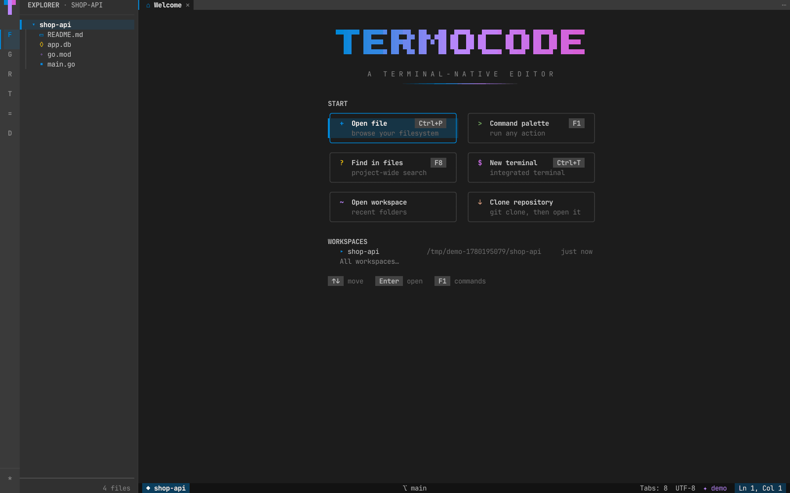
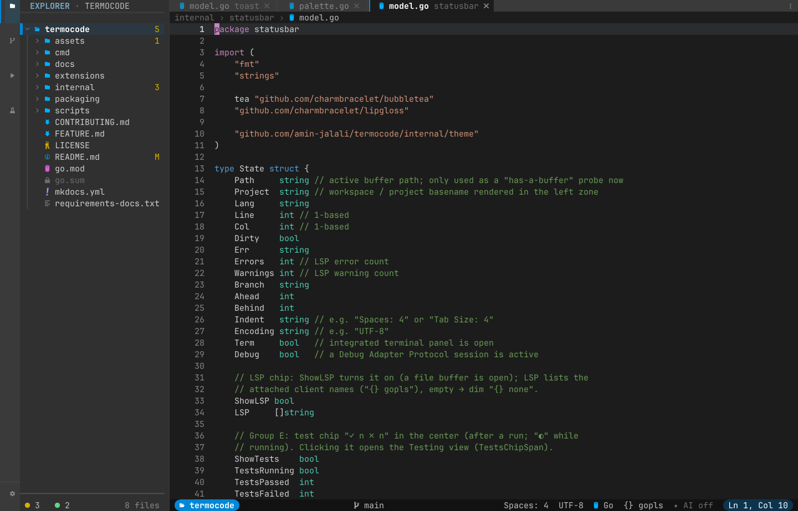
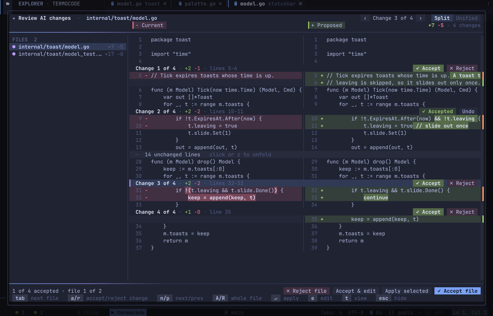
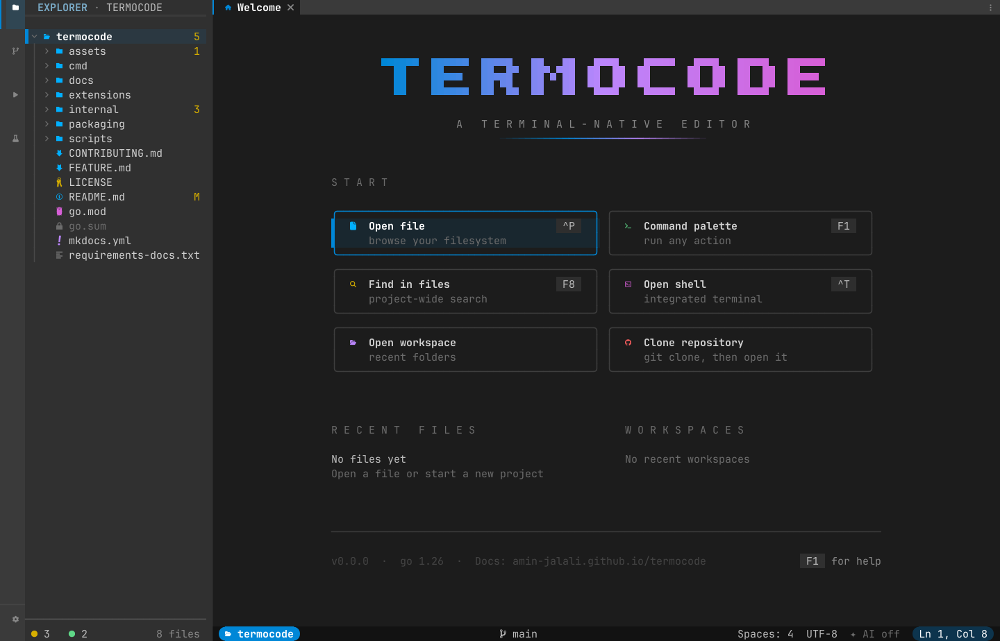
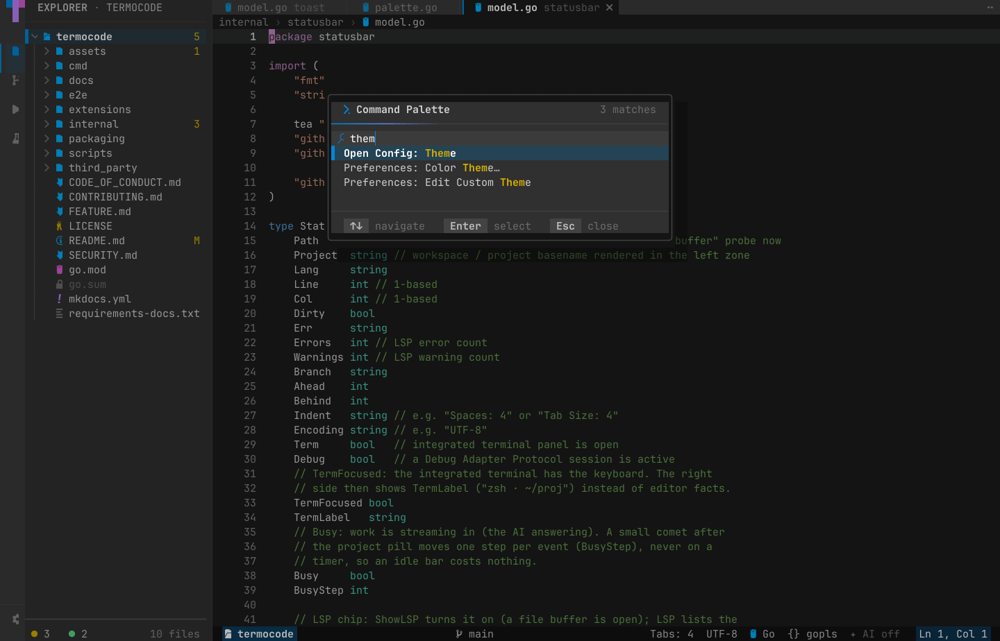
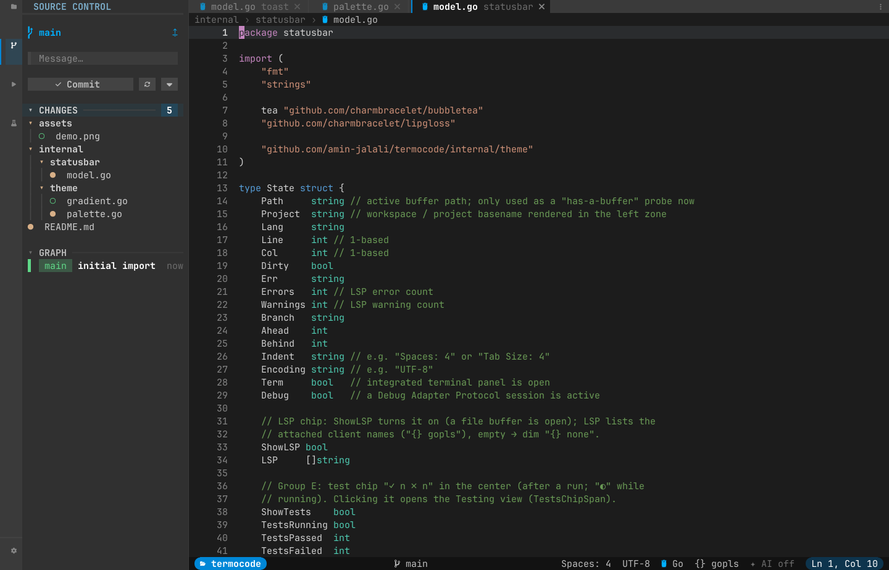
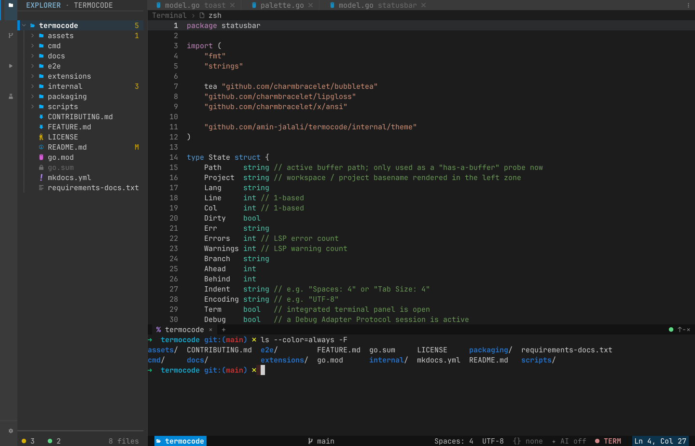
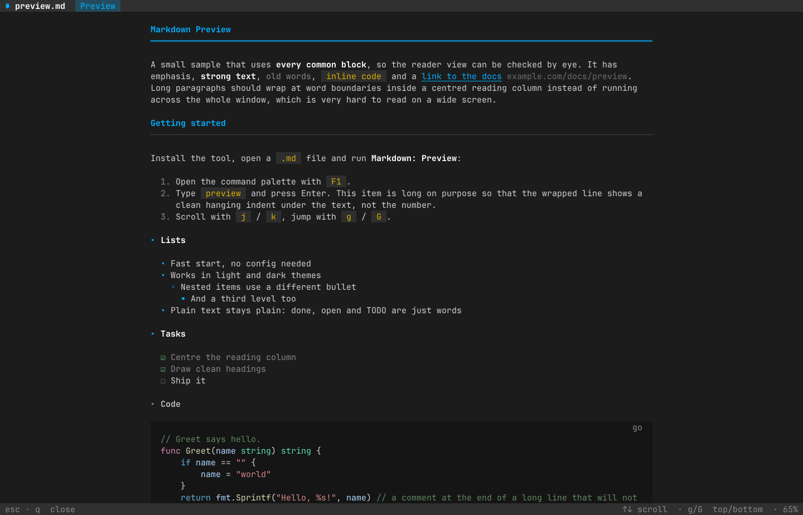
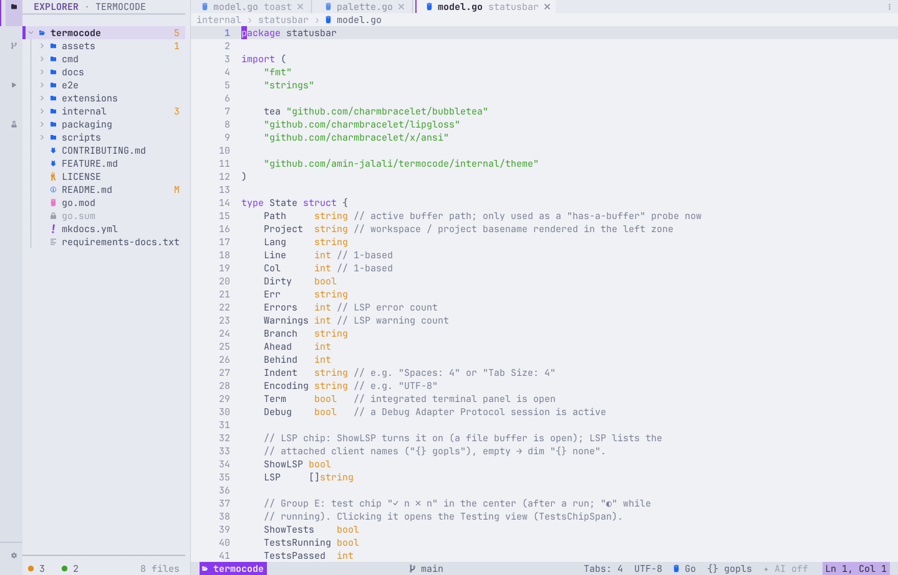

# termocode

[](https://amin-jalali.github.io/termocode/)
[](https://github.com/amin-jalali/termocode/actions/workflows/test.yml)

**The AI-Integrated Terminal IDE.**

Full-Featured. AI-Integrated. Persistent.

A fast, full-featured IDE that runs entirely in your terminal. Code, debug, test, manage Git, run your Docker services, and work with integrated AI agents that create files, edit code and run development tasks, with every change under your control.

**Your Connection Dies. Your Work Lives On.** Terminal sessions, running processes and AI agents keep working after you disconnect. Reconnect and pick up where you left off.

**Status:** early release (v0.1.x). Linux, macOS and Android (Termux). No Windows build yet; use WSL.

**Documentation: <https://amin-jalali.github.io/termocode/>**



<table>
  <tr>
    <td width="50%"><br><sub><b>Editor</b> — project explorer, tabs, breadcrumbs and source control status.</sub></td>
    <td width="50%"><br><sub><b>AI edit review</b> — accept or reject each change, then apply.</sub></td>
  </tr>
  <tr>
    <td><br><sub><b>Start page</b> — open files, recent files, workspaces, clone.</sub></td>
    <td><br><sub><b>Command palette</b> (<code>F1</code>) — every action, fuzzy search.</sub></td>
  </tr>
  <tr>
    <td><br><sub><b>Source Control</b> — commit box, change tree and commit graph.</sub></td>
    <td><br><sub><b>Terminal</b> — integrated shell panel under the editor.</sub></td>
  </tr>
  <tr>
    <td><br><sub><b>Markdown preview</b> — a clean reader view for <code>.md</code> files.</sub></td>
    <td><br><sub><b>Themes</b> — light and dark, here Catppuccin Latte.</sub></td>
  </tr>
</table>

## Highlights

- **A full IDE, in your terminal** — explorer, tabs, command palette (`F1`), multi-cursor, an integrated terminal with tabs, project-wide search, tasks and a Problems panel. Mouse works everywhere.
- **AI agents in your workflow** — agents create files, edit code and run commands inside the IDE. You review and approve each change, hunk by hunk. Chat, ghost-text completion and Explain / Fix / Edit. Hosted providers or a local model.
- **Disconnect, keep working** — lose your SSH connection and the editor, terminals, running jobs and AI agents keep going. Run `termocode` again in the same folder to get everything back. On by default over SSH; turn on `persistent_session` to get the same when you close a local terminal.
- **MCP** — local and remote MCP servers, and a *Connect a service* wizard for GitHub, GitLab, Linear, Notion, Sentry, Slack, ClickUp and Atlassian.
- **Git** — stage hunks, commit, sync, stash, blame, a commit graph, a merge-conflict resolver and clone.
- **Debug and test** — breakpoints, watch, call stack and a Debug Console for Go, Python and Node; a test explorer for Go, pytest, Rust, Jest and Vitest.
- **Your dev stack** — Docker Compose services (start, stop, logs, shell in a container) and an HTTP client for `.http` files.
- **Language servers** for Go, Python, JS/TS, Rust, C/C++, Lua and more, with a built-in installer.
- **Fast and light** — one binary, starts in under 70 ms, about 60 MB of RAM with its editor engine, near-zero CPU when idle ([benchmarks](https://amin-jalali.github.io/termocode/benchmarks/)).
- **Works where you do** — Linux, macOS, over SSH (with file upload and download) and Android via Termux.
- **Make it yours** — themes, a theme editor, key bindings, snippets, settings export and Lua extensions. Persian and Arabic text shows right to left in the AI chat and Markdown.

## Install

termocode runs on Linux and macOS (amd64 and arm64). It needs `nvim` ≥ 0.10.
One line, no sudo — it installs to `~/.local/bin`:

```sh
curl -fsSL https://raw.githubusercontent.com/amin-jalali/termocode/main/scripts/install.sh | sh
termocode            # opens the current folder
```

On the first start termocode downloads three editor plugins from GitHub in the
background (multi-cursor, debugger, bracket colours). Until they arrive those
features are off; everything else works offline.

Run the same line again to upgrade. Uninstall with `... | sh -s -- --uninstall`.
You can also download a tarball from [Releases](https://github.com/amin-jalali/termocode/releases),
or build with Go ≥ 1.26: `go install github.com/amin-jalali/termocode/cmd/termocode@latest`
(on Linux, install the X11 headers first: `sudo apt install libx11-dev`).
See the [install guide](https://amin-jalali.github.io/termocode/getting-started/install/).

Something not working? Run `termocode setup`, or **Help: Run Doctor** from the palette (`F1`).

## Learn more

- [First 5 minutes](https://amin-jalali.github.io/termocode/getting-started/first-steps/)
- [Guides](https://amin-jalali.github.io/termocode/features/) · [Reference](https://amin-jalali.github.io/termocode/reference/)
- [Architecture](docs/architecture.md) · [Decisions](docs/adr/README.md) · [Contributing](CONTRIBUTING.md)

## CI

Every push and PR runs the test matrix (Ubuntu + macOS) via `.github/workflows/test.yml`.
Tagged releases (`v*`) trigger `.github/workflows/release.yml`.
Pushes to `main` that touch the docs rebuild the site via `.github/workflows/docs.yml`.
